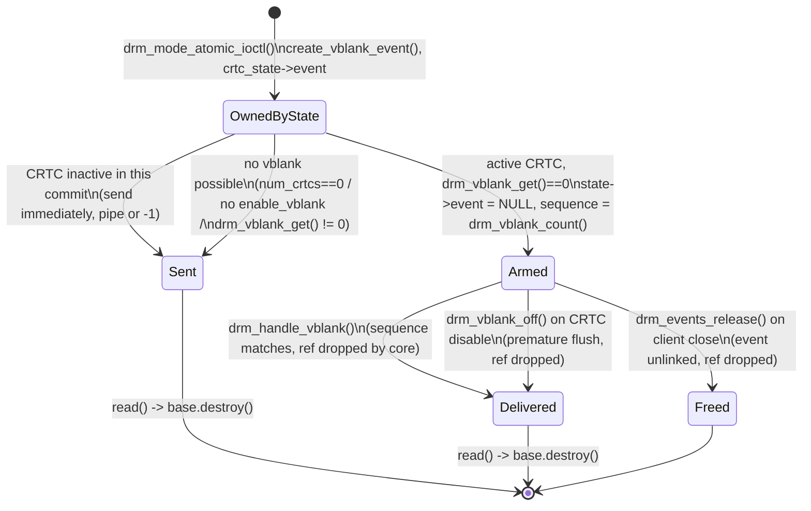

# DECON KMS vblank / flip-event completion (KmsFence)

Slice: `KmsFence` (plan §6 #15). Deliverable of this slice:

| Artifact | Path |
|---|---|
| Kernel source (new file only) | `code/gpu31/kms/exynos_drm7580_fence.c` → `drivers/gpu/drm/exynos/exynos_drm7580_fence.c` |
| Patch | `patches/drm-kms/0001-kmsfence-vblank-flip-events.patch` (new file, 324 lines, applies on pristine + M0) |
| Contract implemented | `exynos7580_commit_tail()`, `exynos7580_vblank_irq()` from `code/gpu31/kms/exynos_drm7580.h` |
| Build evidence | `make ARCH=arm64 CROSS_COMPILE=aarch64-linux-gnu- KCFLAGS=-Wno-error -j8 drivers/gpu/drm/` → exit 0, 0 errors, 0 warnings in this file |

Neither the header nor any sibling file is modified; the patch adds exactly one
`.c` file. The Makefile line used for the build lives only in the private work
tree (assembly owns wiring).

---

## 1. What this slice owns, and what it deliberately does not

```
atomic commit (KWin / modetest / kmscube)
        |
        | mode_config.funcs.atomic_commit            (decon main/CRTC)
        v
  +-------------------------------------------------------------+
  | 4-step order REQUIRED by assembly (agreed with Main/DeconCrtc)|
  |  1. fallible DSI-link + DECON pre-enable, abort on error      |
  |  2. drm_atomic_helper_prepare_planes()                        |
  |  3. drm_atomic_helper_swap_state()                            |
  |  4. exynos7580_commit_tail(state)      <-- this file          |
  +-------------------------------------------------------------+
        |
        |  pre_planes -> commit_planes -> post_planes
        |  (DeconPlane issues the single synchronous decon_kms_commit())
        |  then: arm events, wait one vblank, cleanup, free state
        v
  exynos7580_vblank_irq(drm, 0)   <-- DECON FRAME interrupt (hard IRQ)
        |
        drm_handle_vblank(dev, 0)       3.10 core: count++, wake, send events
```

* This file never programmes hardware and never touches DECON registers. The
  frame is programmed by the plane/CRTC slices before the tail arms anything.
* It is the **only** place that touches `crtc_state->event`. DeconCrtc and
  DeconPlane must not send or arm PAGE_FLIP events (a second sender would be a
  double completion).
* `drm_atomic_helper_commit()` (the M0 helper) must **not** be used by the
  driver: it performs planes+wait+cleanup but never arms `crtc_state->event`,
  so every flip would be answered only by userspace's 1 s timeout
  (`decon-kms-req.md` #22).

---

## 2. The 3.10 vblank API actually used

This tree predates `struct drm_vblank_crtc`, `drm_crtc_vblank_get/put()`,
`drm_crtc_handle_vblank()` and `drm_crtc_arm_vblank_event()` (the latter is
upstream v4.4). The backport in M0 kept the old API, so this file uses it
directly:

| Primitive | Location | Use here |
|---|---|---|
| `unsigned int dev->num_crtcs` | `include/drm/drmP.h:1204` | "was `drm_vblank_init()` called?" guard |
| `drm_vblank_init(dev, n)` | `drm_irq.c:213` | must be called by the main slice before any commit |
| `dev->driver->enable_vblank(dev, pipe)` | `drmP.h:797` | called by `drm_vblank_get()` on the 0→1 transition |
| `dev->driver->get_vblank_counter(dev, pipe)` | `drmP.h:782` | only used by `drm_update_vblank_count()`; main may return `drm_vblank_count()` |
| `int drm_vblank_get(dev, pipe)` | `drm_irq.c:953` | take **one** reference per armed event; failure = no vblank |
| `void drm_vblank_put(dev, pipe)` | `drm_irq.c:1000` | core drops our reference on delivery/disable/release; `BUG_ON(count == 0)` |
| `u32 drm_vblank_count(dev, pipe)` | `drm_irq.c:796` | sampled under `event_lock` when arming (sequence) |
| `bool drm_handle_vblank(dev, pipe)` | `drm_irq.c:1353` | the 3.10 `drm_crtc_handle_vblank()`: timestamp, `++_vblank_count`, wake `dev->vbl_queue[pipe]`, then `drm_handle_vblank_events()` |
| `dev->vbl_queue[pipe]` | `drm_irq.c:224,269` | woken by `drm_handle_vblank()`; waited on by `drm_atomic_helper_wait_for_vblanks()` |
| `dev->vblank_event_list` | `drm_stub.c:263` (init), `drm_irq.c:1315` | process-wide armed-event list |
| `dev->event_lock` | `drmP.h` | protects the list and each event; held by arm and by delivery |
| `drm_send_vblank_event(dev, pipe, e)` | `drm_irq.c:861` | immediate completion with correct timestamp; `event_lock` required |
| `drm_vblank_off(dev, pipe)` | `drm_irq.c:1019` | CRTC disable flush: sends every armed event for that pipe and drops its reference |
| `drm_events_release()` | `drm_fops.c:400-422` | client exit: unlinks its armed events and drops their references |

### 2.1 Minimal `drm_crtc_arm_vblank_event()` equivalent

Upstream v4.4's function does exactly three things, reproduced in
`exynos7580_arm_vblank_event()`:

```c
assert_spin_locked(&dev->event_lock);
e->pipe = pipe;
e->event.sequence = drm_vblank_count(dev, pipe);
list_add_tail(&e->base.link, &dev->vblank_event_list);
```

`drm_handle_vblank_events()` (3.10, `drm_irq.c:1315`) then sends every event
on the list whose pipe matches and whose sequence is not "too old"
(`(seq - e->event.sequence) > (1 << 23)` → skip). Arming with the *current*
count therefore means "deliver on the first vblank at or after this arm", which
is precisely the first vblank after the synchronously latched frame. Arming
with `count + 1` would be wrong here: it would push the event one full frame
late in the common case where the commit's own frame interrupt already
incremented the counter.

The reference discipline is not optional: `drm_handle_vblank_events()` calls
`drm_vblank_put(dev, e->pipe)` for every event it sends
(`drm_irq.c:1315-1345`), so an event on the list **must** own one reference or
`drm_vblank_put()` hits its `BUG_ON(refcount == 0)`. `exynos7580_commit_tail()`
takes that reference with `drm_vblank_get()` *before* queueing the event.

---

## 3. State machine of one flip event



Invariants encoded in the code:

1. `crtc->state->event` is set to `NULL` **before** the event is queued or
   sent. After that point the only owner is the DRM core (`vblank_event_list`
   → `file_priv->event_list` → `base.destroy()` at `read()`/`close()`).
2. An event is in exactly one of: owned by the atomic state, queued on
   `vblank_event_list` with one vblank reference, or sent (no reference). No
   transition repeats.
3. The event pointer lives in the *new* CRTC state (`crtc->state` after
   `swap_state`), so `drm_atomic_state_free()` of the old states can never free
   it, and `drm_atomic_helper_crtc_destroy_state()` (plain `kfree`) never sees
   it either.

## 4. Sequence: normal flip, and the two "no vblank" paths

```mermaid
sequenceDiagram
    participant U as userspace (KWin)
    participant IO as MODE_ATOMIC ioctl
    participant T as exynos7580_commit_tail
    participant P as DeconPlane
    participant D as DECON hw
    participant IRQ as exynos7580_vblank_irq
    participant C as drm core (vblank)

    U->>IO: ATOMIC, NONBLOCK|PAGE_FLIP_EVENT, user_data
    IO->>IO: create event, crtc_state->event = e
    IO->>T: prepare_planes(); swap_state(); commit_tail()
    T->>P: commit_pre_planes (modeset disables/mode_set)
    T->>P: commit_planes -> atomic_update
    P->>D: decon_kms_commit() (synchronous: shadow latch + FRAME wait)
    T->>P: commit_post_planes (enable outputs)
    T->>C: drm_vblank_get(dev,0)  [reference held for the event]
    T->>C: event_lock: pipe=0, sequence=count(), list_add_tail
    T->>C: wait_for_vblanks(): wait_event_timeout(vbl_queue[0], 50 ms)
    IRQ->>C: drm_handle_vblank(dev,0)
    C->>C: count++, wake vbl_queue[0]
    C->>C: drm_handle_vblank_events(): unlink e, drm_vblank_put(0), send
    C-->>T: wait_event_timeout returns
    T->>T: cleanup_planes(); drm_atomic_state_free()
    C-->>U: read(): DRM_EVENT_FLIP_COMPLETE, user_data, tv_sec/tv_usec

    Note over T,C: CRTC inactive in this commit, or drm_vblank_get() fails:
    T->>C: event_lock: drm_send_vblank_event(dev, pipe|-1, e) — no reference
    C-->>U: event delivered immediately, commit never waits for an IRQ
```

Ordering argument for the arm vs. the interrupt: both `drm_handle_vblank()`
(count+delivery) and the arm run under `dev->event_lock`, and the arm samples
`drm_vblank_count()` inside that critical section. Therefore either

* the IRQ ran first → our sequence equals the incremented count and the event
  is delivered by the *next* vblank (one frame late, categorically not lost), or
* the arm ran first → the same IRQ delivers it (not twice: the delivery unlinks
  it under the same lock).

The `drm_vblank_get()` reference is taken *before* the arm, so the interrupt is
guaranteed to be enabled (0→1 calls `enable_vblank()`) at the moment the event
becomes visible, and the reference is guaranteed to exist at the moment the
core drops it.

---

## 5. Interaction with `decon_kms_commit()` (serialization)

The DECON window API has a synchronous (`decon_kms_commit()`) and an
asynchronous (`decon_kms_commit_async()`, Android `sync_fence` + update
kthread) flavour (`decon-kms-api.md` §1, §7.2). This slice requires the
synchronous one:

* `decon_kms_commit()` returns only after the shadow registers were
  unprotected and the vendor path waited for the frame interrupt that latches
  them (300 ms vsync wait + 300 ms `DECON_UPDATE` poll, bounded). DeconPlane
  issues exactly one such call from its plane hook inside
  `drm_atomic_helper_commit_planes()`.
* Therefore `exynos7580_commit_tail()` arms the event **after** the frame is
  programmed. The event's vblank is the first one after the latch, i.e. the
  vblank at which the new frame is scanned out — not a vblank that could
  precede the hardware commit.
* The synchronous tail also makes commits serialize: the M0 atomic ioctl holds
  `dev->mode_config.mutex` for its whole run and commit_tail runs inside it, so
  only one tail (and one arm per CRTC) can be in flight at a time. The M0
  helper's own commit path relies on the same property.
* If a future M2 change adopts `decon_kms_commit_async()` (e.g. to avoid the
  blocking commit for zero-copy flips), the tail **must** wait for that
  commit's completion fence before arming. The current code and the plane slice
  do not do that, and mixing async commits with this arm would let the event
  overtake the frame programming (visible as a flip event before the new
  buffer is scanned out).

Legacy cursor: this tree's `drm_atomic_helper` also services legacy cursor
updates (`state->legacy_cursor_update`); the tail skips the vblank *wait* for
them in `drm_atomic_helper_wait_for_vblanks()`, but events are still armed
normally if a CRTC state carries one. DECON has no hardware cursor plane, so no
cursor path exists in practice (`decon-kms-req.md` #25).

---

## 6. Completion guarantees (exact)

For every atomic commit that requests `DRM_MODE_PAGE_FLIP_EVENT`:

1. **Exactly one event per CRTC per commit.** The ioctl creates at most one
   `crtc_state->event` per CRTC; the tail consumes it once and clears the
   pointer. A second tail cannot see it.
2. **Never lost.** If a vblank can occur, the event is on
   `dev->vblank_event_list` before the tail returns, with a vblank reference
   keeping the interrupt enabled until delivery. If a vblank cannot occur, the
   event is sent before the tail returns.
3. **Never double.** Delivery unlinks the event under `event_lock`
   (`drm_irq.c:1326-1340`); `drm_vblank_off()` and `drm_events_release()` do
   the same. The pointer in the CRTC state is already `NULL`, so no other
   path can re-send it.
4. **No hang.** The only blocking wait is
   `drm_atomic_helper_wait_for_vblanks()` with its 50 ms `wait_event_timeout`,
   which is skipped when `dev->num_crtcs == 0` and per-CRTC when
   `drm_vblank_get()` fails. `enable_vblank()`/`disable_vblank()` are main's
   hooks; `enable_vblank()` must fail when the pipe is not running so that the
   "dark display" case takes the immediate path.
5. **Off/inactive commit.** A commit that clears the CRTC `ACTIVE` state
   completes its event immediately, after the CRTC disable hook called
   `drm_vblank_off()` (flush of the previous event). No event is armed on a
   dead pipe.
6. **Client death.** Any armed event still on the list when the file is closed
   is unlinked and its vblank reference dropped by `drm_events_release()`
   (`drm_fops.c:400-422`); the reference can never leak past the client.
7. **Timestamps.** `drm_handle_vblank()` records the vblank timestamp and
   `drm_send_vblank_event()`/`send_vblank_event()` copy it into
   `tv_sec/tv_usec`, so `drmEventContext.version = 3` +
   `page_flip_handler2` in KWin gets a real timestamp. (3.10's
   `DRM_CAP_TIMESTAMP_MONOTONIC` remains the module-parameter choice,
   `decon-kms-req.md` #24.)

---

## 7. What assembly must wire (outside this file)

1. `drm_vblank_init(&drm, 1)` in probe, *before* the CRTC can be used.
2. `drm_driver.get_vblank_counter/enable_vblank/disable_vblank` (main slice):
   `get_vblank_counter` may return `drm_vblank_count(dev, 0)`; `enable_vblank`
   must enable the DECON FRAME interrupt and fail if the pipe is off;
   `disable_vblank` releases it.
3. The DECON FRAME interrupt must call
   `exynos7580_vblank_irq(&ex->drm, 0)` (directly, or via
   `decon_kms_register_vblank_cb()` with a thunk). It must be called for every
   frame interrupt once the pipe is on; `drm_handle_vblank()` ignores
   spurious/redundant ones.
4. CRTC `disable`/DPMS-off path must call `drm_vblank_off(dev, 0)` (DeconCrtc
   confirmed it will) so armed events are flushed when the pipe goes dark.
5. `mode_config.funcs.atomic_commit` uses the four-step order of §1, never
   `drm_atomic_helper_commit()`.
6. The contract header needs no change for this slice. (It previously included
   `<drm/drm_connector.h>`, which does not exist in 3.10; Main has since removed
   that include — this build used the fixed header. If a stale header is used,
   the error is a missing include, not a code error.)

---

## 8. Build verification

Private tree `/run/media/asdf/db69437b-ed35-414a-8bd1-bade16b06830/j7k/kms/KmsFence`
(copy of the read-only vendor tree, `git apply` 0001..0004 of
`patches/drm-atomic/` clean, contract header copied to
`drivers/gpu/drm/exynos/`, file added to `exynosdrm-y` in the tree only):

```
$ make ARCH=arm64 CROSS_COMPILE=aarch64-linux-gnu- KCFLAGS=-Wno-error -j8 drivers/gpu/drm/
  CC      drivers/gpu/drm/exynos/exynos_drm7580_fence.o
  LD      drivers/gpu/drm/exynos/exynosdrm.o
  LD      drivers/gpu/drm/exynos/built-in.o
  LD      drivers/gpu/drm/built-in.o
EXIT=0
```

* 0 errors.
* Warnings in the whole build: 11, all pre-existing and none in this file
  (`exynos_drm_fb.h` header-guard ×4, `exynos_drm_dmabuf.c:289`,
  `exynos_drm_gem.c:211,476,483`, `exynos_drm_g2d.c:1156,1174` — the same list
  M0 reported).
* Patch check:

```
$ cd <pristine + M0 tree> && git apply --check \
      /tmp/j7repo/patches/drm-kms/0001-kmsfence-vblank-flip-events.patch
CHECK_OK_M0
```

* New-file hunk: `@@ -0,0 +1,324 @@`, `create mode 100644
  drivers/gpu/drm/exynos/exynos_drm7580_fence.c`, 1 file changed, 324
  insertions(+).

No device, flash or reboot was used for this slice.

---

## 9. Test plan (for the boot seat)

| Test | Expectation |
|---|---|
| `modetest -M exynos -a -v` (60 s) | no `Pageflip timed out`, continuous events |
| 300 `kmsflip` page flips | exactly 300 events, one per commit, `user_data` echoed, monotonic `tv_usec` deltas ≈ 16.7 ms |
| `modetest -a -s <conn>:720x1280-60`, then Ctrl-C | event for the final commit not lost; no `premature vblank event` flood in dmesg |
| Client killed mid-flip (`kill -9 kmscube`) | no `BUG_ON(vblank_refcount == 0)`, no stuck `vbl_queue` waiter |
| DPMS off commit (`modetest -a -w <crtc>:ACTIVE:0`) | flip event arrives immediately, no 1 s timeout |
| Commit before `drm_vblank_init` (probe ordering bug) | immediate completion, no NULL deref (guarded by `dev->num_crtcs`) |

dmesg gates: no `drm:*vblank*` WARN, no `BUG`, no `timeout of updating decon
registers` from the commit path.
