# Display power contract: clocks, `pd_disp`, and runtime PM

Slice 5 (`DispPower`) of the DECON KMS port (`decon-kms-plan.md` §6). This document is
the **power/clock contract** the KMS subdriver (M1 slices 10–15) must satisfy, plus what
the vendor fbdev driver does today and the failure modes when a piece of it is missing.

Kernel tree (read-only) = `android_kernel_samsung_universal7580-2a746c1bc1a41eae05988c153f527c8a5dc72d07/`;
all `path:line` citations below are relative to it unless prefixed with `patches/` or
`docs/`. Device evidence is read-only (`/var/log/dmesg`, `/sys`, `debugfs`) from
`user@172.16.42.1`, kernel int49 (`3.10.108`), captured 2026-11-23.

**Headline result:** the display block's power contract is fully described by the
**shipped DT payload** — nothing in it needs a DT edit, which matters because S-Boot
consumes the shipped `dt.img` and a rebuilt one is a brick risk
(`patches/drm-kms-coexist/DESIGN.md` §4). A KMS driver bound to the existing
`decon_fb@14830000` node inherits the 23-clock list, the `samsung,power-domain = <&pd_disp>`
attachment, and the panel rail description via `dsim@14800000`'s `decon_board` phandle. It
gets *none* of this for free if it binds a new node.

---

## 1. Evidence base

| Source | What it proves |
|---|---|
| `drivers/video/exynos/decon_7580/decon-int_drv.c:131-201` | DECON clock list, order of PLL/mux/divider programming |
| `decon_7580/decon_core.c:2542-2592` | runtime-PM callbacks (clocks only), `decon_pm_ops` has no system suspend |
| `decon_7580/decon_core.c:894-1126` | `decon_enable`/`decon_disable` power sequencing |
| `decon_7580/decon_core.c:4385-4832` | probe / remove: what is powered, when, what is leaked |
| `decon_7580/dsim_drv.c:746-828, 846-950, 1585-1622` | DSIM clocks + panel rail sequencing + runtime PM |
| `arch/arm64/boot/dts/exynos7580.dtsi:1078-1200, 1654-1660` | the DT power contract (clocks, `samsung,power-domain`, `pd_disp`) |
| `arch/arm64/mach-exynos/pm_domains.c:66-150, 283-313, 355-444, 621-638` | how `pd_disp` is implemented, attached, and switched off at boot end |
| `drivers/base/power/domain.c:657-707, 1011-1043` | genpd runtime/system ordering guarantees |
| `drivers/clk/samsung/clk-exynos7580.c` | CCF names, gates, fixed-rate roots, divider parents |
| `drivers/iommu/exynos-iommu.c:2140-2173` | genpd `restore_state` hook the display depends on |
| `drivers/bts/bts-exynos7580.c:1602-1642` | MIF bandwidth vote the display must make |
| device `/var/log/dmesg` (boot, t≈12.8–14.7 s) | measured clock rates, pd attach order, restore latency, wakelock |

---

## 2. The DISP power domain (`pd_disp`)

### 2.1 Hardware and DT

```
pd_disp: pd-disp@10464080 {            /* exynos7580.dtsi:1654-1660 */
        compatible = "samsung,exynos-pd";
        reg = <0x0 0x10464080 0x0 0x20>;   /* PMU DISP block */
        pd-option = <0x2>;
        bts-status = "enabled";
};
```

The domain gates the whole `0x1480_0000`–`0x1487_ffff` group: `dsim@14800000`,
`decon_fb@14830000`, `sysmmu@14860000` (`iommu-domain_disp`, `exynos7580.dtsi:1535-1557`)
and **CMU_DISP at PA `0x1487_0000`** (`arch/arm64/mach-exynos/include/mach/regs-clock-exynos7580.h:24`).
CMU_DISP holds every display gate and PLL-control register, so *clocking and domain power
are one resource*: touching a display clock with the domain off is an access to unpowered
silicon.

### 2.2 How a device joins the domain

The 7580 has no `power-domains =` genpd binding; it uses the vendor property
`samsung,power-domain` plus a **platform-bus notifier**:

- `arch/arm64/mach-exynos/pm_domains.c:425-444` — `BUS_NOTIFY_BIND_DRIVER` →
  `exynos_read_domain_from_dt()`, which resolves `samsung,power-domain` and calls
  `exynos_add_device_to_pd()` (`:355-385`, → `__pm_genpd_add_device` + `pm_genpd_dev_need_restore`).
- `BUS_NOTIFY_UNBOUND_DRIVER` → `pm_genpd_remove_device()`.

Therefore **attachment happens on driver bind, before `probe()`**:

```
[   12.835932] PM DOMAIN: pd-disp, Device : 14800000.dsim Registered
[   13.224040] PM DOMAIN: pd-disp, Device : 14830000.decon_fb Registered
[   13.232423] decon 14830000.decon_fb: exynos-iommu gpd_dev_ops inserted!
```

(`/var/log/dmesg` on the device; the third line is `exynos-iommu.c:2191-2203` adding
save/restore callbacks for the DECON device's sysmmu context.)

Consequence: a driver that binds a *different* node (e.g. a new KMS node) loses the
automatic attachment unless that node also carries `samsung,power-domain = <&pd_disp>`;
without it, nothing ever powers the block.

### 2.3 Runtime behaviour (genpd, 3.10 vendor flavour)

- Initial state: `exynos_pm_powerdomain_init()` sets `pd->status = true` and
  `pm_genpd_init(&pd->genpd, NULL, !pd->status)`, i.e. **the domain starts powered on**
  (`pm_domains.c:283-313`). This is why probe-time register access works at all: the
  bootloader left DISP powered (see §5.2).
- `pm_runtime_get_sync(dev)` → genpd `pm_genpd_runtime_resume()` powers the domain on
  **first** (`domain.c:657-707`), then the driver's `->runtime_resume` runs. A driver may
  program CMU_DISP/DECon registers from its own `runtime_resume` unconditionally.
- `pm_runtime_put_sync(dev)` → driver `->runtime_suspend`, then genpd may power the domain
  off once every device in it is suspended (`genpd_suspend_dev_sync`, `domain.c:379-386`).
- Rotation: `exynos_pm_domain_idle()` runs `pm_genpd_poweroff_unused()` at
  `late_initcall_sync` (`pm_domains.c:633-638`), **after** the display drivers' own
  `late_initcall` probes (`decon_core.c:4890`, `dsim_drv.c:1645`). Observed:
  `[14.711122] PM DOMAIN: Power off unused power domains.` — `pd_disp` survives this only
  because dsim and decon hold runtime references.
- Latency: the domain advertises 1 ms on/off (`pm_domains.c:289-290`) and a 500 µs
  restore budget (`gpd_td`, `pm_domains.c:348-353`). DECON blows through it — measured
  `decon 14830000.decon_fb: state restore latency exceeded, new value 29433808 ns`
  (**29.4 ms** to restore the display device's state after a domain transition; the value
  comes from the first restore at boot, so it includes the one-shot clock-rate dump and is
  an upper bound, not a steady-state figure). Either way, any design that expects to power
  the display down and back up inside one frame is wrong; KWin's first commit after resume
  will take tens of milliseconds.

### 2.4 Who is *not* in the domain

`sysmmu@14860000` has **no** `samsung,power-domain` (`exynos7580.dtsi:1543-1557`), yet its
clocks (`aclk_smmu_disp_mmu`, `pclk_smmu_disp_mmu`) are CMU_DISP gates and its SFRs are in
the DISP block. Its register access is only valid while the DECON device holds the domain
up. That is exactly the ordering the vendor relies on (`decon_enable()`: `pm_runtime_get_sync`
at `decon_core.c:925` before `iovmm_activate()` at `:948`).

---

## 3. Clock inventory

### 3.1 DECON (`decon_fb@14830000`)

DT lists 23 clocks (`exynos7580.dtsi:1088-1140`). The driver uses two mechanisms: a
16-entry helper table (`decon_7580/decon_helper.c:28-45`, enum in `decon_helper.h:27-44`)
and 7 direct `clk_get()`s (`decon-int_drv.c:131-169`).

| DT `clock-names` | CCF name / id | role | rate (measured) |
|---|---|---|---|
| `pclk_decon0` | `CLK_PCLK_DECON_INT` → `pclk_decon_int` | APB/SFR access gate, child of `dout_pclk_disp_100` | **100 MHz** |
| `aclk_decon0` | `CLK_ACLK_DECON0` → `aclk_decon_int` | DMA/AXI master gate, child of `mout_aclk_disp_200_user` | **200 MHz** |
| `decon0_eclk` | `CLK_SCLK_DECON_INT_ECLK` → `sclk_decon_int_eclk` | DECON core clock, child of `dout_sclk_decon_int_eclk` | **160 MHz** |
| `decon0_vclk` | `CLK_SCLK_DECON_INT_VCLK` → `sclk_decon_int_vclk` | pixel/output clock, child of `dout_sclk_decon_int_vclk` | **64 MHz** (`disp_pll` 64.5 MHz) |
| `aclk_disp` | `CLK_ACLK_XIU_DISP1` → `aclk_xiu_disp1` | XIU/AXI interconnect gate | **200 MHz** |
| `aclk_disp_200` | `CLK_ACLK_DISP_200` → `aclk_disp_200` | parent gate of the `aclk_decon0` mux; never `clk_prepare_enable()`d directly — enabled as a parent | 200 MHz (derived) |
| `mif_pll` | PLL `mif_pll` | read-only; used only in the underrun report (`decon-int_drv.c:108-109`) | — |
| `disp_pll` | PLL `disp_pll` | source of `vclk`; **set to 64.5 MHz** from `disp-pll-clk` | 64.5 MHz |
| `bus_pll` | PLL `bus_pll` | source of `eclk` + `aclk`; table has a single 800 MHz entry (`clk-exynos7580.c:303-307`) | 800 MHz (derived: /5 = 160, /4 = 200) |
| `mout_sclk_disp_decon_int_eclk_a`, `…_b` | MUXes | `bus_pll` selection path for `eclk` | — |
| `mout_sclk_decon_int_eclk_user`, `sclk_disp_decon_int_eclk`, `dout_sclk_disp_decon_int_eclk` | USERMUX/GATE/DIV | user mux → gate → /5 divider (`decon-int_drv.c:186-189`) | 160 MHz |
| `m_decon0_eclk`, `d_decon0_eclk` | MUX/DIV | final `/1` divider before `decon0_eclk` | — |
| `m_decon0_vclk`, `d_decon0_vclk` | MUX/DIV | `disp_pll` → `/1` | 64.5 MHz |
| `mout_aclk_disp_200`, `dout_aclk_disp_200` | MUX/DIV | user mux → `/4` (`:195-196`) | 200 MHz |
| `mout_aclk_disp_200_user` | USERMUX | parent of `aclk_decon0` and of `dout_pclk_disp_100` (`clk-exynos7580.c:851-853, 1096`) | 200 MHz |
| `d_pclk_disp` | DIV | `/2` of `mout_aclk_disp_200_user` (`:200`) | 100 MHz |

Programming order is significant and is re-executed on **every** runtime resume
(`decon_runtime_resume` → `decon_int_set_clocks`, `decon_core.c:2551`):

1. `clk_set_rate(disp_pll, pdata->disp_pll_clk)` — `decon-int_drv.c:181`
2. `eclk` mux chain then `/5` divider — `:184-189`
3. `vclk` mux (`disp_pll`) then `/1` — `:191-192`
4. `aclk` mux chain then `/4` — `:195-196`
5. `pclk` `/2` — `:200`
6. **then** the gates: `pclk, aclk, eclk, vclk, aclk_disp` (`decon_core.c:2553-2557`)

The dividers *derive their rate from the parent* (`decon_clk_set_divide()` measures
`clk_get_rate(parent)` and programs `parent/(divider+1)`, `decon_helper.c:139-165`), so the
`bus_pll` rate must be sane before step 2.

Pixel-clock arithmetic [INFERENCE]: 720×1280 panel, `h-porch = <48 56 4>`,
`v-porch = <5 13 2>` (`exynos7580-j7elte_rev06.dts:1051-1053`) → 828 × 1300 × 60 Hz =
64.584 MHz, i.e. `disp-pll-clk = <64500000>` (`:1014`) runs ~0.13 % low → ≈59.92 Hz
refresh. Do not "fix" this: the panel is tuned for it.

Latent defects in the vendor code that a copy-paste KMS driver would inherit:

- The helper table has `mout_aclk_disp_333_user` (index 4, `decon_helper.c:34`) which is
  **not** in the DT `clock-names` and is never used → any future use returns `-ENOENT`.
- `decon_probe()` ignores the return of `decon_int_get_clocks()` (`decon_core.c:4427`).
- `decon_put_clocks()` forgets `aclk_disp_200` (`decon_core.c:2532-2540`).
- `decon_clk_set_*()` failures are logged and ignored (`decon_helper.c:98-166`), so a
  mis-parented mux silently leaves the bootloader's value in place.

### 3.2 DSIM (`dsim@14800000`)

DT lists 5 clocks (`exynos7580.dtsi:1177-1188`); `dsim_get_clocks()` requires all of them
(`dsim_drv.c:746-819`):

| DT `clock-names` | CCF name / id | role | rate (measured) |
|---|---|---|---|
| `pclk_dsim0` | `CLK_PCLK_DSI_LINK0` → `pclk_dsi_link0` | APB/SFR | **100 MHz** |
| `mipi0_rx` | `CLK_PHYCLK_RXCLKESC0` → `phyclk_rxclkesc0` | D-PHY escape clock | **20 MHz** (fixed root, `clk-exynos7580.c:498`) |
| `mipi0_bit` | `CLK_PHYCLK_BITCLKDIV8` → `phyclk_bitclkdiv8` | byte clock (HS/8) | **188 MHz** (fixed root, `:497`) |
| `rgb_vclk0` | `CLK_SCLK_DSI_LINK0_I_RGB_VCLK` → `sclk_dsi_link0_i_rgb_vclk` | RGB vclk *generated by DECON* into DSIM | **166 MHz** (fixed root, `:501`) |
| `pclk_disp` | `CLK_PCLK_DECON_INT` → `pclk_decon_int` | **the same CCF clock DECON uses** | **100 MHz** |

Two rules fall out of this:

- `rgb_vclk0` must be enabled **before** DECON starts and disabled **after** it stops —
  stated in `dsim_get_clocks()` (`dsim_drv.c:770-773`).
- `pclk_decon_int` is shared, so **CCF refcounts must balance across the two drivers**.
  A KMS driver that disables `pclk_decon0` while the DSIM half is still registered will
  break DSIM register access (and vice versa).

The D-PHY PLL is **not** a CCF clock: it is programmed inside DSIM from
`timing,dsi-hs-clk` (481 in the j7elte panel node, `dts:1054`). Measured/observed:
`calculated P(6),M(444),S(2) and HS clock(481)`, `escape clock divider is 0x4`,
`escape clock is 15 MHz` (`dsim_reg_7580.c:620-665, 786-856`). A KMS DSI encoder that
replaces the vendor DSIM driver must reproduce this; the CCF clocks above are only the
CMU-side gates.

---

## 4. Regulators, reset, backlight

Panel rails are not in DECON/DSIM code; they are a **DT-scripted sequence** hung off the
**dsim** node:

```
dsim_0: dsim@14800000 { lcd_info = <&ea8061>; decon_board = <&decon_board_list>; ... };
decon_board_list: decon_board_list {
        dsim_set_panel_power_enable  { type = "regulator,enable","regulator,enable","delay,usleep";
                                       regulator = "LCD_1P8","LCD_3P0"; delay = <10000 11000>; };
        dsim_set_panel_power_disable { type = "delay,usleep","gpio,low","delay,usleep",
                                              "regulator,disable","regulator,disable";
                                       gpios = <&gpd1 3 0x1>;
                                       delay = <5000 6000>, <10000 11000>;
                                       regulator = "LCD_3P0","LCD_1P8"; };
        dsim_reset_panel { type = "gpio,high","delay,usleep","gpio,low","delay,usleep",
                                  "gpio,high","delay,usleep"; ... };
};
```

(`exynos7580-j7elte_rev06.dts:1019-1043`; rev00 uses a different sequence — see
`docs/reports/display.md` P2.)

| Rail | PMIC | Order |
|---|---|---|
| `LCD_1P8` | LDO31 (`rev06.dts:669-671`) | enabled **first**, disabled **last** |
| `LCD_3P0` | LDO30 (`rev06.dts:662-664`) | enabled second, disabled first |
| reset | `gpd1-3` | high/10 ms/low/10 ms/high/10 ms after rails |
| backlight | **none** — EA8061 internal, driven over DSI | `backlight_device_register("panel", dsim->dev, …)` (`panels/ea8061_lcd_ctrl.c:1563`), brightness 0-355 |

Implementation: `decon_board.c:449` `run_list()`, action dispatch `:370-410`
(`regulator_bulk_get(NULL, 1, …)` at `:318-323`, `regulator_enable/disable` at `:386-393`,
delays at `:396-402`, pinctrl at `:405`). On the device today:
`/sys/class/backlight/panel/{max_brightness,actual_brightness}` = `355 / 350` and the rails
are owned by the vendor DSIM driver, so **the KMS DSI-encoder slice must own this
sequence** — it is the only thing standing between "CRTC disabled" and "panel off".

Because rev00/04/06 differ only here, the KMS encoder must parse the list from DT rather
than hard-code it [inference: the same code path is board-revision-dependent by
construction].

---

## 5. What the fbdev driver does today

### 5.1 Power model as implemented

| Phase | Code | What happens |
|---|---|---|
| probe, clocks | `decon_core.c:4427` | `decon_int_get_clocks()` — 7 `clk_get()`, return value ignored |
| probe, domain | `:4622` `:4630` | `pm_runtime_enable()` then `pm_runtime_get_sync()` → `pd_disp` on, `runtime_resume` programs CMU + enables 5 gates |
| probe, iommu | `:4530-4537` | `iovmm_activate()` (sysmmu SFRs live in DISP) |
| probe, boot state | `:4524-4546`, `:4635-4685` | see §5.2 |
| probe, wakelock | `:4743-4752` | `device_init_wakeup(dev, true)` + `pm_stay_awake()` — holds the AP awake while the panel is on |
| screen on | `decon_enable()` `:894-1012` | `pm_runtime_get_sync()` → `s_stream(1)` → `decon_reg_init()` (full SWRESET+init) → `decon_reg_start()` → `pm_stay_awake()` |
| screen off | `decon_disable()` `:1014-1126` | `s_stream(0)` → `decon_reg_stop()` (per-frame off + linecnt wait + SWRESET) → `iovmm_deactivate()` → `pm_runtime_put_sync()` → `pm_relax()` |
| fb blank | `decon_blank()` `:1129-1176` | `FB_BLANK_POWERDOWN/NORMAL` → `decon_disable`; `UNBLANK` → `decon_enable` |
| runtime PM | `:2589-2592` | `dev_pm_ops = { .runtime_suspend, .runtime_resume }` — **nothing else** |
| system suspend | — | **no `.suspend`/`.resume`**: the wakelock held by `pm_stay_awake()` is what keeps the platform from suspending while the panel is on |
| remove | `:4819-4842` | `pm_runtime_disable()` then `decon_put_clocks()`; no `pm_relax()`, no `device_init_wakeup(false)` |
| shutdown | `:4844-4860` | `decon_disable()` only (no rail teardown) |

Device confirmation of the wakelock: `/sys/kernel/debug/wakeup_sources` has
`14830000.decon_fb  active_count=2 …` while the screen is on, and `/sys/power/state` is
`freeze mem` with `autosleep=off` — i.e. today *userspace* DPMS (fb blank) is the only way
the display (and therefore suspend) is ever turned off.

`CONFIG_DECON_LPD_DISPLAY` is **not set** in the shipped config
(`arch/arm64/configs/lineageos_j7elte_defconfig:2351`), so the LPD/ULPS idle path
(`decon-int_drv.c:997-1060`, trigger `decon.h:859-873`) is dead code in this image. Only
`fb_blank` matters.

Only runtime-PM is registered, and genpd's system-suspend callbacks
(`domain.c:1011-1043`) only call the iommu's save/restore ops
(`exynos-iommu.c:2165-2173`) — **never the display driver's**. So DECON register state is
*not* saved across a domain power cycle by anything; the vendor re-inits from scratch in
`decon_enable()` (`decon_reg_init()` at `:957`). This is the single most important
behavioural fact for atomic KMS: after any `pm_runtime` cycle the CRTC must be re-armed
with a full modeset, not a delta.

### 5.2 The bootloader-left-running rule

S-Boot runs `LCD_ON_UBOOT` and hands over a **live** DECON + DSIM + panel with its own
framebuffer. The kernel detects this by reading `VIDCON0` bit 2
(`VIDCON0_DECON_STOP_STATUS`, `regs-decon.h:19`; reader `decon_reg_7580.c:266-275`) and has
three strategies (`decon_core.c:4524-4546, 4635-4685`): reuse the bootloader fb
(`CONFIG_DECON_USE_BOOTLOADER_FB`), or `decon_reg_init_probe()` + per-frame off + wait for
linecnt 0, or a full `decon_reg_init()`. The shipped image has
`# CONFIG_DECON_USE_BOOTLOADER_FB is not set` (`defconfig:2363`), so
`decon_is_no_bootloader_fb()` returns 1 (`decon_helper.c:21-27`) and the driver **always
stops and re-initialises the pipe** — the panel momentarily keeps its content because the
DSIM/panel are not reset at that point.

Two hard rules for the KMS driver:

1. **Never assume reset register values.** The first thing touching DECON must either
   `decon_reg_reset()` (`decon_reg_7580.c:19-36`, SWRESET poll) or run the bootloader-fb
   branch first. Writing window registers over a bootloader-armed DECON without stopping it
   is how the earlier attempt produced a dark screen with no `fb0`
   (`patches/drm-kms-coexist/DESIGN.md` §4).
2. **Do not require a DT change.** The DT the bootloader parses is the shipped payload; a
   rebuilt `dt.img` is a brick risk (`DESIGN.md` §4: "a rebuilt `dt.img` … is a brick
   risk, hence the absolute DT rule"). Everything the power contract needs — clocks,
   `samsung,power-domain`, `decon_board`, `lcd_info` — is already in the shipped DTS of
   `decon_fb@14830000` and `dsim@14800000`.

---

## 6. The contract for the KMS subdriver

### 6.1 Layering (who owns what)

| Layer | Resource | Owner in KMS design | If you own it instead |
|---|---|---|---|
| SoC power | `pd_disp` | genpd, attached automatically by the bus notifier at bind | must add `samsung,power-domain` to your node **and** call `pm_runtime_*` |
| CMU | 23 DECON + 5 DSIM clocks | the device whose node lists them (CCF) | `clk_get(name)` per DT; gate refcounts shared with any vendor driver still bound |
| PHY | D-PHY PLL/byte/escape | DSIM register block (not CCF) | program from `timing,dsi-hs-clk`/`dsi-escape-clk` |
| Panel | `LCD_1P8`, `LCD_3P0`, reset, backlight | DSIM node's `decon_board` list | parse & run the list, per board revision |
| Bus | BTS/MIF vote | `decon_set_qos()` → `exynos7_update_media_scenario(TYPE_DECON_INT, bw, 0)` (`decon_core.c:1989-2009`, `bts-exynos7580.c:1602-1642`) | must make the same vote or MIF is left to the governor |

The BTS vote is not cosmetic: with `CONFIG_EXYNOS7580_BTS=y` (`defconfig:3463`) the display
scenario pins MIF at 416 MHz (`bts-exynos7580.c:1628-1632`) and programs the traffic shaper;
dropping the call on disable also drops the PM-QoS release (`:1641`), pinning MIF up
(battery) or leaving the shaper stale (underruns).

### 6.2 State machine

```mermaid
stateDiagram-v2
    state "Bound (pd_disp attached by bus notifier)" as Bound
    state "ClocksGot (clk_get, ioremap, IRQ)" as ClocksGot
    state "Powered (pd on, CMU programmed, gates on)" as Powered
    state "Quiesced (pipe stopped, no CRTC)" as Quiesced
    state "Scanning (DECON streaming)" as Scanning
    state "Suspended (clocks off, pd may be off)" as Suspended
    state "Removed" as Removed

    [*] --> Bound
    Bound --> ClocksGot : probe returns 0
    ClocksGot --> Powered : pm_runtime_get_sync
    Powered --> Powered : runtime_resume reprograms CMU
    Powered --> Quiesced : bootloader pipe stopped
    Quiesced --> Powered : pm_runtime_put_sync
    Quiesced --> Scanning : first atomic commit
    Scanning --> Quiesced : DPMS off, CRTC inactive
    Scanning --> Suspended : system suspend
    Quiesced --> Suspended : system suspend
    Powered --> Suspended : system suspend
    Suspended --> Powered : resume, get_sync + full re-commit
    Quiesced --> Removed : remove or shutdown
    Powered --> Removed : remove or shutdown
    Suspended --> Removed : remove
    Removed --> [*]

    note right of Powered
      Registers ARE accessible, no CRTC active.
      Any commit may be a full modeset.
    end note
    note right of Scanning
      DECON streaming, vblank live, BTS vote active.
      Panel rails on, DPHY and panel initialised.
    end note
    note right of Suspended
      pd_disp may be OFF, so NO register access.
      CRTC and plane state must be re-committed on resume.
    end note
```



### 6.3 Probe

1. `clk_get()` every DECON clock by DT name **and check the return** (the vendor does not,
   `decon_core.c:4427`). Missing name → `-EPROBE_DEFER` (provider may still be probing),
   permanently missing → `-ENODEV`, never continue with an `ERR_PTR`.
2. ioremap DECON (`0x14830000`) **and** DSIM (`0x14800000`); do not touch either yet.
3. `pm_runtime_enable(dev)`; `pm_runtime_get_sync(dev)`. The bus notifier has already
   attached `pd_disp`, so this powers the domain and then runs your `runtime_resume`, which
   must do exactly: `disp_pll` rate → eclk mux chain + `/5` → vclk mux + `/1` → aclk mux +
   `/4` → pclk `/2` → `clk_prepare_enable(pclk, aclk, eclk, vclk, aclk_disp)`.
   This is the *only* place CMU_DISP may be programmed from.
4. `iovmm_activate(dev)` (sysmmu clocks live in CMU_DISP; must be after step 3).
5. Quiesce the bootloader pipe: `decon_reg_reset()` (or the `decon_reg_init_probe` +
   linecnt-wait dance if you want to preserve the splash).
6. Register CRTC/planes/encoder/connector, `drm_vblank_init`, request `interrupts[2]`
   (frame-done; `interrupts[0]` is the FIFO/underrun line). **Do not** power the panel here.
7. Do **not** take a permanent `pm_stay_awake()`: the vendor's wakelock exists because it has
   no system-suspend hooks. KMS must implement §6.6 instead.
8. End probe with `pm_runtime_put_sync()` *unless* you are displaying something (fbdev
   emulation handover). Leaving a reference is safe; releasing it is what lets `pd_disp`
   breathe.

### 6.4 First modeset (CRTC becomes active)

Strict order — each step depends on the previous one's clocks:

1. `pm_runtime_get_sync()` → `pd_disp` on, CMU programmed, gates on.
2. `iovmm_activate()` if it was released.
3. Panel rails: run `dsim_set_panel_power_enable` (LDO31 1P8 → LDO30 3P0 → 10 ms).
4. DSIM clocks: `pclk_dsim0`, `rgb_vclk0`, `pclk_disp` (`dsim_runtime_resume`,
   `dsim_drv.c:1604-1616`); then D-PHY `mipi0_rx` + `mipi0_bit` for the stream
   (`:885-886`). `rgb_vclk0` before DECON starts.
5. D-PHY PLL/byte/escape from `timing,dsi-hs-clk` = 481 → P6/M444/S2, byte = hs/8,
   esc divider 4 (`dsim_reg_7580.c:786-856`).
6. Panel reset (`dsim_reset_panel` gpio script) → panel init (`ea8061` sequences) →
   `displayon`.
7. DECON: `decon_reg_init()` (SWRESET + VIDCON/blend/window defaults,
   `decon_reg_7580.c:414-446`) → window config for each plane → shadow update →
   `decon_reg_start()`.
8. BTS: `exynos7_update_media_scenario(TYPE_DECON_INT, decon_calc_bandwidth(xres,yres,4,fps), 0)`
   (mirror `decon_core.c:2004`), before or at the same commit as step 7.
9. Enable the frame-done IRQ / vblank; only then report the flip complete.

If the commit is the very first one after a `pm_runtime` cycle, it must be a **full
modeset** (`DRM_MODE_ATOMIC_ALLOW_MODESET`), because the CRTC/plane registers are gone.

### 6.5 Runtime idle (CRTC inactive / DPMS off)

1. Atomic commit: plane `crtc/fb = NULL`, CRTC `active = 0` (no `disable_all` helper exists
   in the M0 backport — DRMAtomicM0 confirmed the explicit-commit form).
2. `decon_reg_stop()` equivalent: per-frame off → wait linecnt 0 → SWRESET.
3. DSIM stream off (LP-11), then panel off: `dsim_set_panel_power_disable`
   (reset low → LDO30 3P0 off → LDO31 1P8 off), backlight off.
4. `iovmm_deactivate()` — the vendor does this in `decon_disable()` too
   (`decon_core.c:1076`); re-attach before the next commit.
5. BTS vote → 0.
6. `pm_runtime_put_sync()` → gates off → genpd may power `pd_disp` off.
7. From here, **any** register read/write must be preceded by `pm_runtime_get_sync()` and
   must assume power-on defaults (full modeset).

Do not use `pm_runtime` autosuspend to cycle clocks per frame: the domain restore costs
~29 ms (measured), and every cycle invalidates DECon state.

### 6.6 System suspend / resume

DRMAtomicM0's backport has **no** `drm_atomic_helper_suspend()/resume()` and **no**
`drm_atomic_helper_disable_all()` (confirmed by the M0 owner; helper list is
check/commit/commit_planes/wait_for_vblanks/connector_dpms + state duplicate/reset).
Implement it explicitly:

**suspend** (`.suspend` in `dev_pm_ops`, after KWin's DPMS commit or directly):
1. If the CRTC is active: `drm_modeset_lock_all()`, build a state with each plane
   `crtc/fb = NULL` and the CRTC inactive, `drm_atomic_commit()` (step 6.5 items 1–5
   happen here, including rails off), `drm_modeset_unlock_all()`.
2. Save what a full modeset needs to restore: `struct drm_display_mode` copy + connector
   state (the crtc/plane atomic state duplicates available in M0 are enough).
3. `pm_runtime_put_sync()` → clocks off, `pd_disp` may power off. If the CRTC was already
   inactive, only the put is needed.
4. Set a `suspended` flag that makes DPMS/enable/commit paths return `-EBUSY` between
   `.suspend` and `.resume` (DRM's fb helper will call them).

**resume**:
1. Clear the flag, `pm_runtime_get_sync()` → genpd powers `pd_disp` on, your
   `runtime_resume` re-programs CMU and gates.
2. `iovmm_activate()`.
3. `drm_atomic_commit()` the saved mode as a **full modeset** (this replays §6.4 steps 3–9:
   rails, DPHY, panel init, DECON init, BTS).
4. Re-arm vblank; the first frames after resume will be late (~29 ms class).

Nothing in the PM core will do this for you: the DECON device carries no system-suspend
callback of its own (`decon_core.c:2589-2592` is runtime-only), and the per-device
callbacks that the display SYSMMU driver installs on it (`exynos-iommu.c:2165-2173`,
observed as `exynos-iommu gpd_dev_ops inserted!`) only save/restore the SYSMMU context —
they then chain to a driver `.suspend/.resume` that does not exist. So a system suspend
today simply leaves `pd_disp` following whatever runtime state the driver left behind.

### 6.7 Remove / shutdown

- Atomic commit all-off (same as 6.5 items 1–5).
- `drm_mode_config_cleanup()`, `iovmm_deactivate()`, free IRQ.
- `pm_runtime_put_sync()` then `pm_runtime_disable()` — in that order, with the refcount
  back to zero. The vendor does `pm_runtime_disable()` first (`decon_core.c:4825`), which
  leaves refs stranded and the domain forced on.
- `clk_put()` all references **including** `aclk_disp_200`, which the vendor leaks
  (`decon_core.c:2532-2540`).
- `shutdown()` must also run the panel-off script; the vendor stops DECON only
  (`decon_core.c:4844-4860`), leaving the panel and LDOs on across a reboot into S-Boot.

---

## 7. Failure modes: what breaks when a piece is missing

| Missing / wrong | Mechanism | Symptom | Grounding |
|---|---|---|---|
| `pd_disp` not powered (device not attached to the domain, or no runtime ref after `pm_genpd_poweroff_unused`) | CMU_DISP (`0x1487_0000`) is inside the domain; `clk_prepare`/`clk_get_rate`/any DECon SFR access hits unpowered logic | **kernel crash / hang**: the vendor documents exactly this — "Accessing the DISP CMU registers while the pd_disp is off makes the system crash" and gates LPD entry on boot completion for that reason | comment at `decon-int_drv.c:986-993`; domain node `dts:1654-1660`; `pm_domains.c:633-638` |
| probe skips `pm_runtime_get_sync()` | domain is switched off at `late_initcall_sync` right after the display probes | first subsequent register access faults; a bootloader-left image freezes | `pm_domains.c:633-638`, observed `[14.711122] PM Power off unused power domains.` |
| clock name missing from DT | `clk_get()` → `ERR_PTR(-ENOENT)`; driver continues (vendor pattern) | **oops in `__clk_prepare`**: it NULL-checks but not `IS_ERR`, so it dereferences `clk->prepare_count` | `drivers/clk/clk.c:722-746`; vendor ignores the error at `decon_core.c:4427` |
| clock exists but resolves to `NULL` | `clk_prepare_enable(NULL)` is a **silent no-op** (`clk.c:726`, `:818`) | register access to a gated block → external abort/hang, with no driver error | `clk.c:722-746, 814-838` [inference from code] |
| `pclk_decon0`/`pclk_dsim0` off while the other driver is live | same CCF clock `CLK_PCLK_DECON_INT` is referenced by both nodes | the other side's register access fails when one driver blanks | `exynos7580.dtsi:1179-1181`, `clk-exynos7580.c:1102` |
| `vclk` (`decon0_vclk`) rate below the panel's pixel clock, or `eclk` too slow | DECON FIFO drains faster than it fills | **underrun**: the FIFO IRQ logs `underrun (level %d), bw(%llu), mif(%ld), chmap(0x%x), win(0x%lx), aclk(%ld)` (`decon-int_drv.c:40-124`) and the crtc line/HOZ can diverge from DSIM ("size mis-match, TRIGCON…", `decon_core.c:2018-2064`) → tearing/flicker/occasional dark frames | code paths above; rate derivation §3.1 |
| `disp_pll` not set (default/bootloader rate) | `vclk = disp_pll`; panel timing 64.584 MHz | refresh wrong → tearing or panel loses sync | `decon-int_drv.c:181-192`, `dts:1014` |
| `rgb_vclk0` disabled while DECON streams | comment: it must be on before DECON starts, off after it stops | no pixel data reaches DSIM → blank/garbled panel | `dsim_drv.c:770-773` |
| D-PHY PLL/HS not programmed (vendor DSIM replaced naïvely) | `dsim_reg_wait_hs_clk_ready()` never completes | HS clock timeout, panel stays dark | `dsim_reg_7580.c:459-472, 786-856` |
| panel rails wrong order / one missing | `LCD_1P8` must precede `LCD_3P0`; disable reversed | panel init NAKs / no display; device log today shows a healthy read `READ ID : 40 00 03` | `rev06.dts:1028-1032`, `decon_board.c:386-402` |
| BTS vote missing/stale | MIF min-freq and traffic shaper come from `TYPE_DECON_INT` | underruns under load; or MIF pinned at 416 MHz after blank (battery) | `bts-exynos7580.c:1602-1642`, `decon_core.c:1989-2009` |
| expecting register state to survive a power cycle | nothing saves DECon state; genpd only restores the iommu context | black screen after resume with a "plane-only" commit | `decon_core.c:957` (full `decon_reg_init` on every enable), `exynos-iommu.c:2165-2173` |

Marked **[inference]** items are read off code paths, not reproduced on hardware.

---

## 8. Verification (main agent / KMS bring-up)

On the current fbdev image (read-only, expected values):

```sh
flock /tmp/gpsdev.lock ssh user@172.16.42.1 \
  'echo nura | /usr/local/bin/rootshell sh -c "grep -E \"PM DOMAIN|Mhz|restore latency|pm_stay_awake\" /var/log/dmesg"'
```

Expected (today, matches §2.3/§3): two `pd-disp … Registered` lines before the drivers'
`probe start`, five `phyclk/pclk` rates at 100/188/166/20 MHz, `aclk_decon_int: 200 Mhz`,
`sclk_decon_int_eclk: 160 Mhz`, `sclk_decon_int_vclk: 64 Mhz`,
`state restore latency exceeded … 29433808 ns`, `pm_stay_awake`,
`PM DOMAIN: Power off unused power domains.` last.

On a KMS build, the power checklist:

1. `dmesg | grep "PM DOMAIN"` — both devices attached, `pd_disp` not powered off while the
   CRTC is active.
2. `cat /sys/bus/platform/devices/14830000.decon_fb/power/runtime_status` — `active` while
   scanning, `suspended` after DPMS off (today: `active`, control `auto`).
3. `dmesg | grep -c "underrun"` after 10 minutes of flips — must be 0 (§3.1 rates are the
   only knob).
4. `kmscube` exit / `modetest` CRTC disable → `runtime_status` back to `suspended` and
   rails off (no `LCD_1P8`/`LCD_3P0` enable counts left over).
5. Suspend smoke: `echo mem > /sys/power/state` with the CRTC off → resume → full modeset
   redraw; expect one ~30 ms hitch, no black screen.
6. No `can't get clock:` lines attributable to the KMS driver (that is the vendor helper's
   silent-failure signature, `decon_helper.c:60-70`).

---

## 9. Open items handed to other slices

- **`DsiEncoder`**: owns the `decon_board` list (rails + reset) and the D-PHY programming;
  the CCF clocks in §3.2 are only its CMU gates.
- **`KmsFbdev` / `DeconCrtc`**: every commit after a `pm_runtime` cycle must be a full
  modeset (§5.1 last paragraph).
- **`KmsCoexist`**: if KMS and the vendor DSIM share the node set, `pclk_decon_int`
  refcounts must balance (§3.2); sharing the same clock from two bound drivers is legal but
  a missing `clk_put` (vendor already leaks `aclk_disp_200`) leaks the display CMU gate.
- **`KmsAssemble`**: `CONFIG_PM_RUNTIME`, `CONFIG_PM_GENERIC_DOMAINS_RUNTIME`,
  `CONFIG_EXYNOS7580_BTS`, `CONFIG_EXYNOS_IOMMU_V6` must stay `y`
  (`defconfig:435,446-449,3462-3463,3239`); the power contract has no optional parts.
